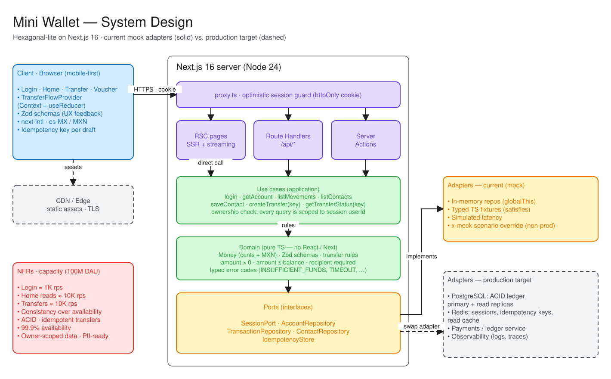
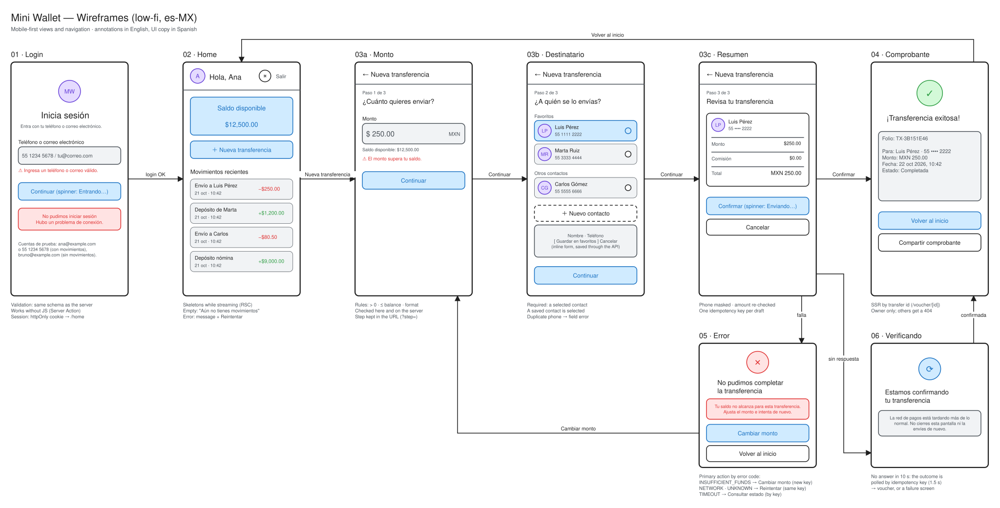

# Mini Wallet Web App

A mini financial wallet built with Next.js 16 + TypeScript as a technical challenge. It simulates a basic money-transfer flow with mocked services:

**Login → Home → New Transaction → Confirmation / Voucher**

- **Login:** phone or email, with validation, loading and simulated error states, and a mocked persisted session.
- **Home:** balance, user name and recent movements, with loading, empty and error states.
- **New Transaction:** amount, a favorite or newly saved contact, and a summary before confirming.
- **Confirmation / Voucher:** a randomized mocked outcome (success, network error, insufficient funds, timeout, unknown), each with its own handling.

Business rules (amount > 0, amount ≤ balance, recipient required) live in a framework-agnostic domain core. They are enforced on the server behind versioned API routes (`/api/v1/*`) and reused in the UI for instant feedback.

## Design

### System design



### Wireframes



### Workflow

The full request flow, including the confirmation scenarios and idempotent retries, is in the [sequence diagram](docs/sequence-diagram.md).

Editable sources: [`system-design.excalidraw`](docs/system-design.excalidraw) and [`wireframes.excalidraw`](docs/wireframes.excalidraw). Open them at [excalidraw.com](https://excalidraw.com) or in the VS Code Excalidraw extension.

### Further reading

- [DECISIONS.md](DECISIONS.md): design decisions and their justification
- [AI_USAGE.md](AI_USAGE.md): how AI tools were used
- [docs/PLAN.md](docs/PLAN.md): working plan, requirements and capacity estimates

## Requirements

- Node.js **24.22.1** (LTS). Pinned in `.nvmrc`. `engines` plus `engine-strict` in `.npmrc` make npm refuse to install on older versions.
- npm 11 (bundled with Node 24)

## Getting started

```bash
nvm use                                # or install the version in .nvmrc
npm ci
npx playwright install chromium webkit # browsers for E2E tests (one-off)
npm run dev                            # http://localhost:3000
```

| Script                  | Description                                           |
| ----------------------- | ----------------------------------------------------- |
| `npm run dev`           | Dev server (Turbopack)                                |
| `npm run build`         | Production build                                      |
| `npm run start`         | Serve production build                                |
| `npm run lint`          | ESLint                                                |
| `npm run typecheck`     | Route type generation + `tsc --noEmit`                |
| `npm run format`        | Format all files with Prettier                        |
| `npm run format:check`  | Verify formatting without writing                     |
| `npm test`              | Unit/component tests (Vitest, single run)             |
| `npm run test:watch`    | Unit/component tests in watch mode                    |
| `npm run test:coverage` | Unit/component tests with v8 coverage (`coverage/`)   |
| `npm run test:e2e`      | E2E tests (Playwright: desktop Chrome, mobile Safari) |
| `npm run test:e2e:ui`   | E2E tests in Playwright UI mode                       |

Vitest and Playwright refuse to start on a Node version older than the one pinned in `.nvmrc`, since jsdom crashes with an obscure `undici` error otherwise; `nvm use` fixes it.

The E2E web server is started automatically on port 3100 (`E2E_PORT`) from a fresh production build, locally and in CI. The dev server is not used: under the test runner, Turbopack HMR keeps forcing full page reloads, which makes interactions flaky.

Besides the user flows and the five confirmation scenarios, the E2E suite checks every screen against WCAG 2.1 AA with axe in both themes (`e2e/a11y.spec.ts`) and completes a transfer with the keyboard only (`e2e/keyboard.spec.ts`).

## Mock data

The services are backed by in-memory adapters seeded from typed fixtures (`src/adapters/mock/fixtures.ts`). Data is kept in memory for the lifetime of the server process.

| User         | Login identifier                      | Scenario                                                                                   |
| ------------ | ------------------------------------- | ------------------------------------------------------------------------------------------ |
| Ana López    | `ana@example.com` or `55 1234 5678`   | Balance of $12,500.00 MXN, movements, contacts                                             |
| Bruno Díaz   | `bruno@example.com` or `55 8765 4321` | Balance of $500.00 MXN, no movements or contacts (empty states)                            |
| Diana Torres | `diana@example.com` or `55 2468 1357` | Balance of $50,000.00 MXN, contacts, no movements; used by E2E flows that create transfers |

Transfer confirmations are answered by a mock payment network that picks a weighted random outcome: success 60%, and 10% each for insufficient funds, network error, timeout and unknown error. The TIMEOUT outcome is modelled as a slow approval, so the result has to be recovered by idempotency key. A specific outcome can be forced per request for testing when overrides are enabled.

The mock behavior is configured through environment variables; see [`.env.example`](.env.example).

| Variable                          | Default                      | Description                                                                           |
| --------------------------------- | ---------------------------- | ------------------------------------------------------------------------------------- |
| `MOCK_LATENCY_MS`                 | `250-700` (`0` under test)   | Simulated latency per mock call (fixed or range)                                      |
| `MOCK_TIMEOUT_DELAY_MS`           | `15000`                      | Delay of the TIMEOUT scenario                                                         |
| `MOCK_SCENARIO_OVERRIDE`          | `enabled` outside production | Whether a forced scenario is honored                                                  |
| `NEXT_PUBLIC_TRANSFER_TIMEOUT_MS` | `10000`                      | Client-side wait for a confirmation before its outcome is checked by key (build time) |

## API

Mock services are exposed as Next.js Route Handlers under the versioned base path `/api/v1`. Authentication is carried by an httpOnly `mw_session` cookie set on login. Errors are returned as [RFC 9457](https://www.rfc-editor.org/rfc/rfc9457) problem details (`application/problem+json`) with a machine-readable `code` and, for validation errors, field-level `issues`. Responses are never cached (`Cache-Control: no-store`).

| Method | Path                                 | Auth | Description                                               |
| ------ | ------------------------------------ | ---- | --------------------------------------------------------- |
| POST   | `/api/v1/auth/login`                 | —    | Starts a session for an email or phone identifier         |
| POST   | `/api/v1/auth/logout`                | —    | Ends the session (idempotent)                             |
| GET    | `/api/v1/account`                    | ✓    | User name and available balance                           |
| GET    | `/api/v1/account/movements?limit=20` | ✓    | Recent movements, newest first                            |
| GET    | `/api/v1/contacts`                   | ✓    | Saved contacts, favorites first                           |
| POST   | `/api/v1/contacts`                   | ✓    | Saves a new contact                                       |
| POST   | `/api/v1/transfers`                  | ✓    | Confirms a transfer; requires an `Idempotency-Key` header |
| GET    | `/api/v1/transfers?idempotencyKey=…` | ✓    | Outcome of a confirmation (recovery after a timeout)      |
| GET    | `/api/v1/transfers/{id}`             | ✓    | Completed transfer for the voucher                        |
| GET    | `/api/health`                        | —    | Liveness probe (unversioned)                              |

Transfer confirmation outcomes are mapped to HTTP statuses:

| Status | Meaning                                        |
| ------ | ---------------------------------------------- |
| 201    | Completed                                      |
| 202    | Still pending: the same key is being processed |
| 422    | Insufficient funds, or a validation error      |
| 503    | Network error; safe to retry with the same key |
| 504    | Timeout                                        |
| 500    | Unknown error                                  |

**Scenario override (testing).** When overrides are enabled (outside production by default), an outcome can be forced with the `x-mock-scenario` header or the `mock_scenario` cookie. Accepted values are `SUCCESS`, `INSUFFICIENT_FUNDS`, `NETWORK`, `TIMEOUT` and `UNKNOWN`.

- On transfer confirmation, the override drives the payment network outcome.
- On other endpoints, `NETWORK` and `UNKNOWN` fail the request and `TIMEOUT` delays it, so that simulated error states can be reproduced.

```bash
curl -i -c jar -H 'content-type: application/json' \
  -d '{"identifier":"ana@example.com"}' http://localhost:3000/api/v1/auth/login
curl -i -b jar -H 'content-type: application/json' \
  -H "Idempotency-Key: $(uuidgen)" -H 'x-mock-scenario: NETWORK' \
  -d '{"amount":{"amount":25000,"currency":"MXN"},"recipientId":"cnt_luis"}' \
  http://localhost:3000/api/v1/transfers
```

Pages are guarded optimistically by `src/proxy.ts`: anonymous visitors are redirected to `/login?next=…`. The session is always verified on the server.

## Tech stack

| Package                       | Version | Notes                                                   |
| ----------------------------- | ------- | ------------------------------------------------------- |
| `next` / `eslint-config-next` | 16.4.2  | Includes the 2026-10-14 security patches (≥ 16.4.1)     |
| `react` / `react-dom`         | 19.3.1  | Pinned. 19.3.1 is React's 2026-10-14 security release   |
| `typescript`                  | 5.9.x   | Stricter flags on top of `strict` (see `tsconfig.json`) |
| `vitest` + Testing Library    | 5.x     | Unit and component tests (jsdom)                        |
| `@playwright/test`            | 1.64.x  | E2E tests                                               |
| `zod`                         | 4.x     | Domain schemas, API contracts and inferred types        |
| `prettier`                    | 3.x     | Formatting, integrated with ESLint                      |
| `tailwindcss`                 | 4.3.x   | Styling via PostCSS; design tokens as CSS variables     |
| `shadcn` (CLI) + `radix-ui`   | 4.x     | Components copied into `src/components/ui` (Nova style) |
| `motion`                      | 14.x    | Animations, lazily loaded and reduced-motion aware      |
| `next-intl`                   | 4.x     | Typed es-MX dictionary, no locale routing               |

## Known limitations

### Dependencies

- **`npm audit` reports 5 high-severity findings.** They come from a single advisory ([GHSA-vfj7-8cjw-p6xm](https://github.com/advisories/GHSA-vfj7-8cjw-p6xm), `braces` stack-exhaustion DoS) pulled in through `eslint-config-next → @next/eslint-plugin-next → fast-glob → micromatch → braces`. It only affects lint tooling at dev time and is not in the runtime bundle. No patched `braces` release exists yet. The `npm audit fix --force` suggestion would downgrade `eslint-config-next` to 14.x, so that fix was not applied.
- **Mock data is not persisted.** It is reset on every server restart, and it is not shared across serverless instances. A database adapter behind the same ports would be required for that.
- **Streamed Home sections need JavaScript.** The header and logout work without it, but the balance and movements are streamed behind skeletons, which are swapped in by inline scripts.
- **The transfer draft is kept in memory.** The step survives in the URL, but a refresh clears the amount and recipient, so the flow restarts at the amount step with a new idempotency key.
- **Login is mocked.** No secret is verified, and unknown identifiers are reported explicitly, which would allow account enumeration in a real system.
- **TypeScript 7 and ESLint 10 were deliberately not adopted.** The project stays on the majors that `create-next-app@16.4.2` sets up and supports (TS 5.x, ESLint 9). ESLint 9.39 prints a "no longer supported" deprecation warning on install.
- **The `unrs-resolver`, `fsevents`, `@parcel/watcher` and `@swc/core` install scripts are denied** (`allowScripts` in `package.json`). They are only fallbacks for building or fetching native binaries, and prebuilt binaries are already shipped. The last two are pulled in by the next-intl message extractor, which is not used.
